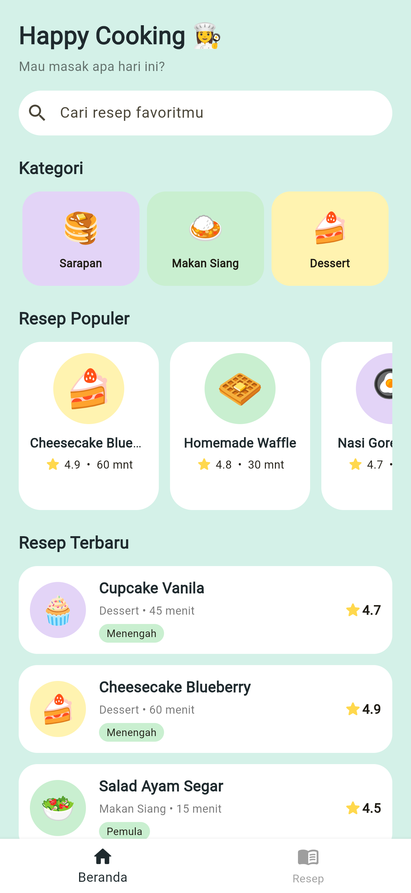
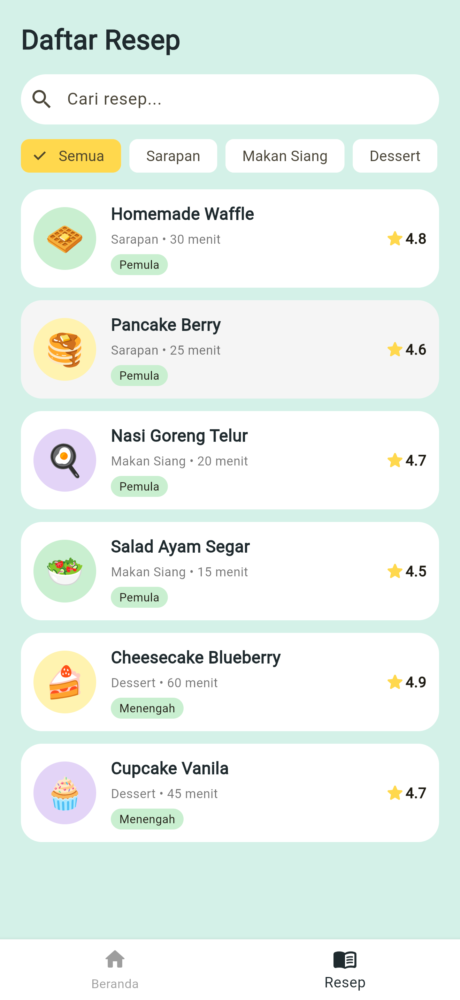

# Dapur Ceria 🍳

Aplikasi resep masakan berbasis Flutter dengan tema aesthetic dan warna cerah (mint, kuning, lilac).
Dibuat untuk UTS Mobile Programming Semester Ganjil 2025/2026.

**Nama:** Nadya Clarisa Az-zahra
**NIM:** 240605110166
**Kelas:** Mobile Programming L

## Tema dan Tujuan
Dapur Ceria membantu pengguna menemukan resep masakan sehari-hari berdasarkan kategori
(Sarapan, Makan Siang, Dessert), lengkap dengan bahan dan langkah memasak.
Desain mengacu pada *Plate Recipes App* oleh Tran Mau Tri Tam (Dribbble), lalu
disesuaikan dengan nama, palet warna, dan susunan elemen sendiri.

## Daftar Halaman
| Halaman | File | Fungsi |
|---|---|---|
| Beranda | `lib/pages/home_page.dart` | Sapaan, pencarian, kategori, resep populer, resep terbaru |
| Daftar Resep | `lib/pages/recipe_list_page.dart` | Daftar resep dengan pencarian dan filter kategori |
| Detail Resep | `lib/pages/recipe_detail_page.dart` | Info, bahan, dan langkah memasak |

Navigasi memakai `BottomNavigationBar` (Beranda, Resep) dan `Navigator.push` (ke Detail).

## Struktur Proyek
```
lib/
├── main.dart
├── theme.dart
├── models/recipe.dart
├── services/recipe_service.dart
├── pages/ (app_shell, home_page, recipe_list_page, recipe_detail_page)
└── widgets/recipe_tile.dart
assets/data/recipes.json
```

## Data
Data dummy disimpan di `assets/data/recipes.json` dan dibaca lewat `RecipeService`.
Model `Recipe` memiliki `fromJson`, sehingga tahap berikutnya cukup mengganti sumber
data ke API tanpa mengubah halaman.

## Cara Menjalankan
1. Pastikan Flutter sudah terpasang (`flutter doctor`).
2. Clone repositori: `git clone <link-repo>` lalu `cd dapur_ceria`
3. Ambil dependensi: `flutter pub get`
4. Jalankan: `flutter run -d chrome` (atau pilih emulator/HP)

## Screenshot



